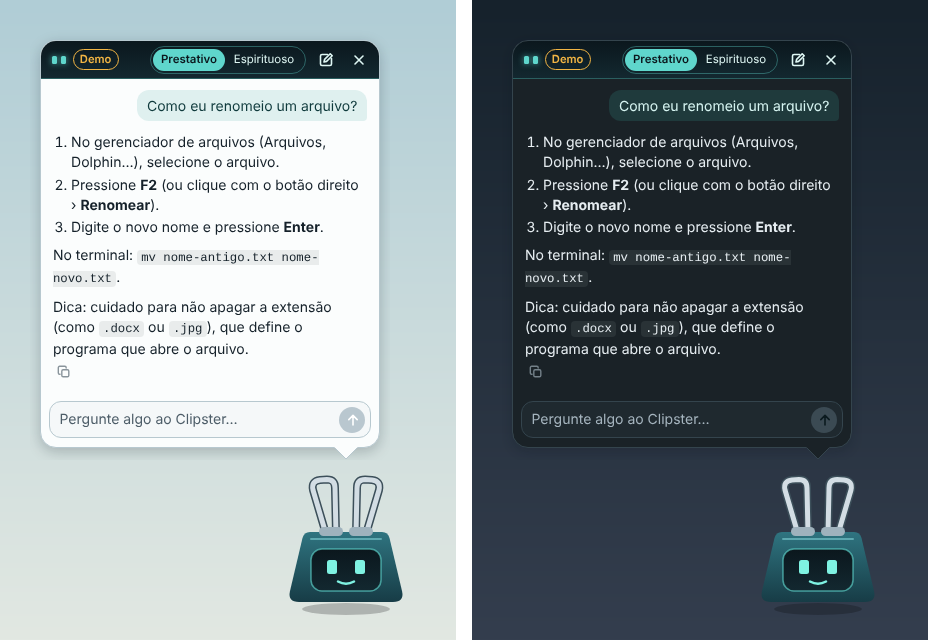
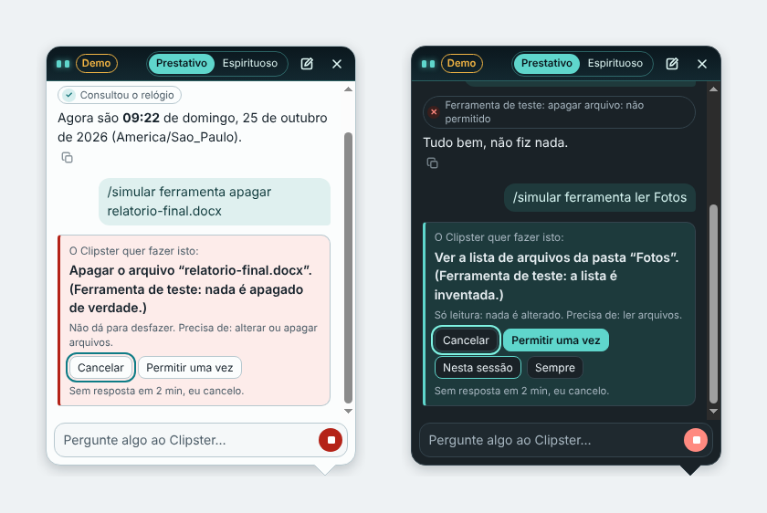
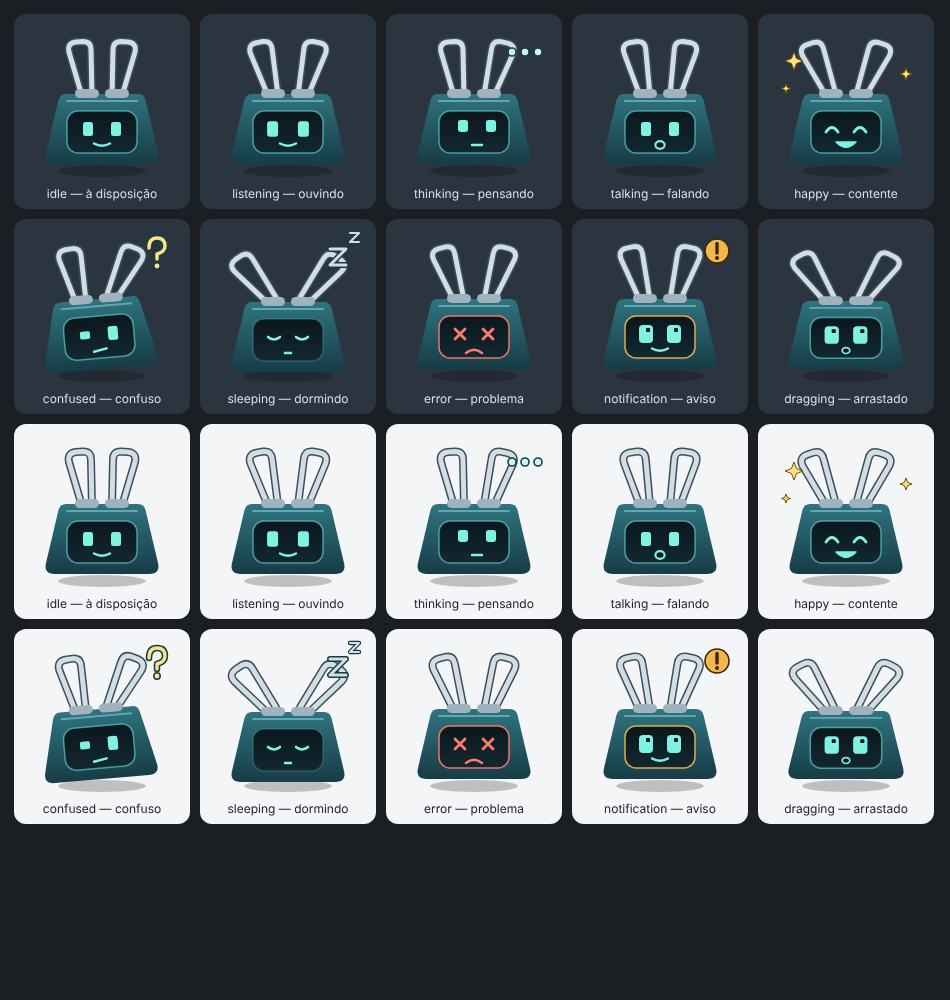

# Clipster

Um pequeno companheiro de desktop, animado, com personalidade e foco em privacidade. Ele fica num canto da tela, pode ser arrastado, e conversa com você num balão usando a IA que você escolher: um modelo rodando no seu computador (Ollama, LM Studio) ou na nuvem (Claude, OpenAI).

> Inspirado nos assistentes de desktop dos anos 90, com identidade própria. **Não afiliado à Microsoft.**

<p align="center">
  
</p>

## Estado atual

Versão **0.5.0**: Fases 0 a 5 do [roadmap](SPEC.md#34-roadmap) concluídas.

| Recurso | Situação |
|---------|----------|
| Personagem transparente, sem moldura, fora da barra de tarefas | ✅ |
| Arrastar o personagem; posição lembrada, inclusive com vários monitores | ✅ |
| Clique através das áreas transparentes (Windows/macOS) | ✅ |
| Ícone na bandeja e menu de contexto (clique direito) | ✅ |
| Configurações: idioma, sempre visível, iniciar escondido, iniciar com o sistema, atalho global, personalidade, tamanhos, animações, tema, histórico | ✅ |
| Interface em português e inglês, seguindo o idioma do sistema | ✅ |
| Uma única instância; fechar ≠ sair | ✅ |
| Estados animados do personagem (10 poses, máquina de estados) | ✅ |
| Cochila depois de um tempo sem interação; acorda confuso ao ser clicado | ✅ |
| **Balão de conversa** com respostas aparecendo aos poucos, botão Parar e Copiar | ✅ |
| **Modo demonstração**: respostas de exemplo, sem IA e sem internet | ✅ |
| **Prestativo / Espirituoso** com troca rápida no balão | ✅ |
| **Primeira execução guiada** (idioma, personalidade, IA) | ✅ |
| Histórico de conversas opcional (desligado por padrão) | ✅ |
| **IA de verdade**: servidor local compatível com OpenAI (Ollama, LM Studio), Claude e OpenAI | ✅ |
| Chave de API no cofre do sistema, lista de modelos, "Testar conexão", mensagens de erro claras | ✅ |
| **Ferramentas** (hora e versão do Clipster), com pedido de permissão para o que acessar o computador | ✅ |
| Privacidade › Permissões: o que já foi permitido, com Revogar | ✅ |

## Conversando com o Clipster

- **Abrir o balão:** clique no personagem, use "Conversar com o Clipster" no clique direito, clique no ícone da bandeja (Windows) ou ligue o atalho global em Configurações › Geral (`Ctrl+Shift+Espaço`).
- **Teclado:** `Enter` envia, `Shift+Enter` quebra a linha, `Esc` para a resposta ou fecha o balão.
- **Personalidade:** troque no próprio balão (Prestativo | Espirituoso), na bandeja ou nas Configurações. A conversa continua; a próxima resposta já vem no tom novo.
- **Modo demonstração:** responde a algumas perguntas de exemplo (renomear arquivo, captura de tela, copiar e colar, que horas são, quem é você), para o seu sistema operacional, em português ou inglês. Fora disso, ele avisa que precisa de uma IA configurada. Sempre aparece com o selo **Demo**.
- **Histórico:** desligado por padrão; sem ele, a conversa dura até "Nova conversa" ou até fechar o app. Ligado em Configurações › Privacidade, fica só no seu computador e a última conversa volta quando você reabre o Clipster.
- **Ferramentas:** a IA pode consultar a hora e a versão do Clipster. Cada uso aparece acima da resposta (ex.: "✓ Consultou o relógio").

### Permissões

Ferramentas que acessam algo do computador pedem antes, dentro do balão, com um texto escrito pela própria ferramenta (nunca pela IA) e o foco começando em **Cancelar**. Enquanto espera, o personagem mostra um aviso.

<p align="center">
  
</p>

- **Leitura:** uma vez, nesta sessão ou sempre. **Alteração:** uma vez ou nesta sessão. **Ação que não dá para desfazer:** só uma vez, toda vez.
- Sem resposta em 2 minutos, o pedido é cancelado. `Esc` e **Parar** também cancelam.
- Configurações › Privacidade › **Permissões** mostra o que vale além de uma vez, com **Revogar**.
- No máximo 5 ferramentas por mensagem. O que uma ferramenta devolve é tratado como dado: nunca concede permissão nem dispara outra ferramenta.
- Cada uso fica registrado no log (ferramenta, decisão e se deu certo), sem os argumentos.

Na versão atual, as duas ferramentas disponíveis (hora e versão) não acessam nada do computador, então nenhuma pede permissão. O pedido de permissão é testado com ferramentas fictícias, que só existem em desenvolvimento com `CLIPSTER_DEV_TOOLS=1`.

**Em desenvolvimento**, o modo Demo aceita comandos que simulam problemas, para ver as mensagens de erro sem gastar nada: `/simular erro 429` (também 401, 404, 402, 529, 400), `/simular timeout` (espera os 30 s do tempo-limite), `/simular offline`, `/simular queda` (cai no meio da resposta) e `/simular markdown` (resposta com link perigoso, imagem e HTML, para conferir que nada disso passa). Com `CLIPSTER_DEV_TOOLS=1` (no PowerShell: `$env:CLIPSTER_DEV_TOOLS=1; npm run dev`), também `/simular ferramenta apagar relatorio.docx` (pedido de uma ação que não dá para desfazer; nada é apagado), `/simular ferramenta ler Fotos` (leitura, com "nesta sessão" e "sempre") e `/simular ferramenta loop` (limite de 5 ferramentas). No app instalado, nada disso existe.

## Estados do personagem

<p align="center">
  
</p>

Quem decide o estado é uma máquina de estados no main process (`src/shared/character/stateMachine.ts`); a janela só desenha. No uso normal você vê: **ouvindo** enquanto digita, **pensando** até a primeira palavra da resposta, **falando** enquanto ela aparece, **com um problema** quando algo dá errado, **contente** na primeira execução e ao trocar de personalidade, **sendo arrastado** durante o arrasto, **dormindo** depois do tempo configurado em Configurações › Geral e **confuso** ao ser acordado com um clique. O estado **com um aviso** fica para as notificações (Fase 5 em diante).

**Para ver todos agora:** em `npm run dev`, clique com o botão direito no personagem › **Pré-visualizar estado (dev)**. Cada estado fica 4 segundos e volta sozinho. Esse submenu não existe no app instalado.

## Requisitos

- **Node.js 24 LTS** (mínimo 22.12). No Windows, baixe o instalador "LTS" em [nodejs.org](https://nodejs.org/).
- Windows 10/11, macOS ou Linux.

## Instalação para desenvolvimento

```bash
npm install
npm run dev
```

O `npm install` também baixa o Electron. O `npm run dev` abre o Clipster com recarga automática da interface. Em desenvolvimento os dados ficam numa pasta separada (`Clipster (dev)`), sem misturar com o app instalado.

## Scripts

| Comando | O que faz |
|---------|-----------|
| `npm run dev` | Abre o app em modo desenvolvimento (recarga automática). |
| `npm run build` | Compila main, preload e interface em `out/`. |
| `npm run preview` | Abre o build de produção localmente. |
| `npm run lint` | ESLint (regras estritas com tipos). |
| `npm run format` / `npm run format:check` | Prettier. |
| `npm run typecheck` | TypeScript estrito nos projetos node, web e e2e. |
| `npm test` | Testes unitários e de integração (Vitest). |
| `npm run test:e2e` | Build + testes E2E com Playwright controlando o Electron. |
| `npm run package` | Gera o instalador para o sistema atual em `release/`. Nunca publica nada. |
| `npm run package:win` | Gera o instalador do Windows (NSIS). |
| `npm run audit` | Auditoria das dependências de produção. |
| `npm run icons` | Regera os PNGs dos ícones a partir dos SVGs em `assets/icons`. |

## Testes

```bash
npm test            # unitários + integração
npm run test:e2e    # E2E (no Linux sem desktop: xvfb-run -a npm run test:e2e)
```

Os testes E2E rodam com `CLIPSTER_E2E=1` e uma pasta de dados temporária: nunca tocam nas suas configurações reais. Eles percorrem o cenário completo do MVP (SPEC §37) e verificam, pelo log de rede do Chromium, que o app não faz **nenhuma** requisição de rede ao abrir nem ao conversar no modo Demo.

Para a IA de verdade, os testes sobem servidores locais que seguem os protocolos da OpenAI e da Anthropic (`tests/support/mockProviders.ts`) e conferem a conversa, as chaves e cada mensagem de erro. A conversa com os serviços reais faz parte do roteiro manual.

Alguns comportamentos só podem ser verificados num desktop de verdade (transparência, bandeja, vários monitores). Para eles há o roteiro manual em [`docs/qa-checklist.md`](docs/qa-checklist.md).

## Empacotamento

```bash
npm run package       # sistema atual
npm run package:win   # Windows (rodar no Windows)
```

- **Windows:** instalador NSIS por usuário (não pede administrador).
- **macOS:** DMG. **Linux:** AppImage.
- O instalador não é assinado digitalmente (decisão D5 da SPEC). O Windows SmartScreen vai mostrar um aviso: clique em "Mais informações" › "Executar assim mesmo".
- No GitHub, o workflow **Build artifacts** (execução manual) gera o instalador do Windows sem publicar release.

## Arquitetura (resumo)

- **Main process** (`src/main`): janelas, bandeja, menus, configurações, IPC, segurança. É a única fonte da verdade das configurações.
- **Preload** (`src/preload`): expõe só `window.clipster`, uma API mínima e tipada. Nunca expõe o `ipcRenderer`.
- **Máquina de estados** (`src/shared/character`): função pura que decide a pose do personagem; roda no main com dois timers no máximo (transitório e inatividade).
- **Conversa** (`src/main/ai`): o `AssistantService` guarda a conversa no main, monta o contexto (`ContextBuilder`), fala com o provider escolhido (Demo, compatível com OpenAI ou Anthropic) pela interface `AIProvider` e envia os pedaços da resposta ao balão. Toda chamada de rede acontece no main.
- **Chaves de API** (`src/main/storage/secretStore.ts`): cifradas com o cofre do sistema (`safeStorage`); a tela só recebe "tem chave, termina em 1234".
- **Ferramentas** (`src/main/tools`, `src/main/permissions`): registro, validação dos argumentos (Zod), permissões, execução com tempo-limite e auditoria, tudo no main. As descrições para a IA ficam com os outros prompts, em `src/shared/personalities/tools.ts`.
- **Personalidades** (`src/shared/personalities`): único lugar com prompts e falas do personagem.
- **Renderers** (`src/renderer`): o personagem (TypeScript puro, sem React por quadro; a arte é um pacote trocável em `assets/character/`), o balão (React, Markdown seguro) e as Configurações (React). Sem Node, sem acesso a arquivos, sem rede.
- **Shared** (`src/shared`): esquemas Zod, i18n, contratos de IPC, constantes.

Detalhes em [`docs/architecture.md`](docs/architecture.md). Decisões registradas em [`docs/decisions.md`](docs/decisions.md).

## Configuração de IA

Tudo em **Configurações › IA**. O modelo é sempre você quem escolhe; o Clipster não tem nenhum fixo.

**Ollama (no seu computador, grátis):**
1. Instale o [Ollama](https://ollama.com/) e baixe um modelo, por exemplo `ollama pull llama3.2`.
2. Em Configurações › IA, escolha **Servidor compatível com OpenAI** e clique em **Ollama** (endereço `http://localhost:11434/v1`).
3. Escolha o modelo na lista e clique em **Testar conexão**.

**LM Studio:** ligue o servidor local na aba Developer do LM Studio, carregue um modelo e use o atalho **LM Studio** (`http://localhost:1234/v1`). O resto é igual.

**Claude (Anthropic):** escolha **Claude**, cole a sua chave de API (criada no Claude Console), clique em **Salvar chave** e escolha o modelo na lista, que vem da própria Anthropic.

**OpenAI:** escolha **Servidor compatível com OpenAI**, clique em **OpenAI** (`https://api.openai.com/v1`), salve a chave e escolha o modelo.

Sobre as chaves:
- Ficam só no seu computador, cifradas pelo cofre do sistema (DPAPI no Windows, Keychain no macOS, keyring no Linux). A tela de Configurações nunca recebe a chave de volta, só os últimos 4 caracteres.
- A chave de um servidor compatível com OpenAI vale só para o endereço em que foi salva: trocar o endereço não manda a chave para outro servidor.
- No Linux sem keyring, o Electron não consegue cifrar de verdade; o Clipster avisa e só salva se você confirmar.

Servidores locais costumam demorar mais para a primeira palavra (o modelo é carregado na memória), por isso o tempo-limite deles é maior: 90 s para começar e 5 min no total (nuvem: 30 s e 2 min).

**Em desenvolvimento**, dá para pôr as chaves num arquivo `.env` na raiz do projeto (veja `.env.example`), em vez de salvar pela tela. O `.env` é ignorado pelo git e o app instalado nunca o lê. `OPENAI_API_KEY` só vale para `https://api.openai.com`.

## Privacidade

O Clipster não observa tela, teclado, área de transferência, arquivos ou outros programas, e não tem telemetria. Ferramentas que acessem algo do computador sempre pedem permissão antes. Configurações, posição, logs e (se você ligar) o histórico ficam só no seu computador. Os logs nunca guardam o conteúdo das conversas. Detalhes em [`docs/privacy.md`](docs/privacy.md).

## Segurança

Isolamento de contexto, sandbox, CSP estrita, protocolo próprio `app://` no lugar de `file://`, IPC com remetente e conteúdo validados, navegação e janelas novas bloqueadas, permissões web negadas, respostas em Markdown sem HTML e sem imagens remotas, ferramentas só no main (argumentos validados, permissão pedida com o texto da própria ferramenta) e Electron Fuses no app empacotado. Detalhes em [`docs/security.md`](docs/security.md).

## Limitações conhecidas

- **Linux:** o clique através das áreas transparentes não é suportado; a bandeja depende de AppIndicator; no Wayland, o arrasto e a restauração de posição não funcionam nativamente (ver [`docs/compatibility.md`](docs/compatibility.md)).
- **Iniciar com o sistema** só funciona no app instalado, no Windows e no macOS.
- Sem assinatura de código (avisos do SmartScreen e do Gatekeeper).
- O pacote `.deb` volta quando o projeto tiver um endereço público (decisão D6).
- O corretor ortográfico fica desligado no campo de texto do balão: ligá-lo faria o Chromium baixar dicionários da internet.
- O atalho global é fixo (`Ctrl+Shift+Espaço`, `⌘+Shift+Espaço` no macOS); escolher outro fica para uma próxima versão.
- A OpenAI é usada pela API Chat Completions, que continua suportada; a API Responses fica para depois (ver [`docs/decisions.md`](docs/decisions.md)).
- Modelos que "pensam" antes de responder: o Clipster mostra o personagem pensando, mas não exibe o raciocínio.

## Roadmap

Fase 6 em [`SPEC.md` §34](SPEC.md#34-roadmap): **polimento e entrega** (acessibilidade, medição de desempenho, vários monitores e DPI, instalador do Windows, roteiro de QA executado).

## Licença

A definir (decisão D1 da [SPEC](SPEC.md#03-decisões-pendentes-do-dono-do-produto)). Até lá, todos os direitos reservados.
