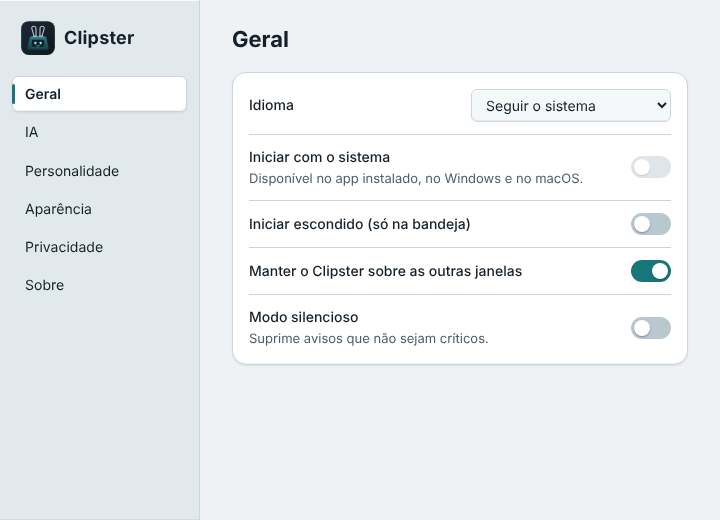

# Clipster

Um pequeno companheiro de desktop, animado, com personalidade e foco em privacidade. Ele fica num canto da tela, pode ser arrastado, e (em breve) conversa com você usando a IA que você escolher.

> Inspirado nos assistentes de desktop dos anos 90, com identidade própria. **Não afiliado à Microsoft.**

<p align="center">
  
  &nbsp;&nbsp;
  
</p>

## Estado atual

Versão **0.1.0**: Fases 0 e 1 do [roadmap](SPEC.md#34-roadmap) concluídas.

| Recurso | Situação |
|---------|----------|
| Personagem transparente, sem moldura, fora da barra de tarefas | ✅ |
| Arrastar o personagem; posição lembrada, inclusive com vários monitores | ✅ |
| Clique através das áreas transparentes (Windows/macOS) | ✅ |
| Ícone na bandeja e menu de contexto (clique direito) | ✅ |
| Configurações: idioma, sempre visível, iniciar escondido, iniciar com o sistema, personalidade, tamanho, animações, tema | ✅ |
| Interface em português e inglês, seguindo o idioma do sistema | ✅ |
| Uma única instância; fechar ≠ sair | ✅ |
| Estados animados do personagem (pensando, falando, dormindo…) | Fase 2 |
| Balão de conversa, modo Demo e personalidades em ação | Fase 3 |
| IA de verdade (Ollama/LM Studio, Claude, OpenAI) | Fase 4 |
| Ferramentas com permissões | Fase 5 |

## Requisitos

- **Node.js 24 LTS** (mínimo 22.12). No Windows, baixe o instalador "LTS" em [nodejs.org](https://nodejs.org/).
- Windows 10/11, macOS ou Linux.

## Instalação para desenvolvimento

```bash
npm install
npm run dev
```

O `npm install` também baixa o Electron. O `npm run dev` abre o Clipster com recarga automática da interface. Em desenvolvimento os dados ficam numa pasta separada (`Clipster (dev)`), sem misturar com o app instalado.

## Scripts

| Comando | O que faz |
|---------|-----------|
| `npm run dev` | Abre o app em modo desenvolvimento (recarga automática). |
| `npm run build` | Compila main, preload e interface em `out/`. |
| `npm run preview` | Abre o build de produção localmente. |
| `npm run lint` | ESLint (regras estritas com tipos). |
| `npm run format` / `npm run format:check` | Prettier. |
| `npm run typecheck` | TypeScript estrito nos projetos node, web e e2e. |
| `npm test` | Testes unitários e de integração (Vitest). |
| `npm run test:e2e` | Build + testes E2E com Playwright controlando o Electron. |
| `npm run package` | Gera o instalador para o sistema atual em `release/`. Nunca publica nada. |
| `npm run package:win` | Gera o instalador do Windows (NSIS). |
| `npm run audit` | Auditoria das dependências de produção. |
| `npm run icons` | Regera os PNGs dos ícones a partir dos SVGs em `assets/icons`. |

## Testes

```bash
npm test            # unitários + integração
npm run test:e2e    # E2E (no Linux sem desktop: xvfb-run -a npm run test:e2e)
```

Os testes E2E rodam com `CLIPSTER_E2E=1` e uma pasta de dados temporária: nunca tocam nas suas configurações reais. Um deles verifica, pelo log de rede do Chromium, que o app não faz **nenhuma** requisição de rede ao abrir.

Alguns comportamentos só podem ser verificados num desktop de verdade (transparência, bandeja, vários monitores). Para eles há o roteiro manual em [`docs/qa-checklist.md`](docs/qa-checklist.md).

## Empacotamento

```bash
npm run package       # sistema atual
npm run package:win   # Windows (rodar no Windows)
```

- **Windows:** instalador NSIS por usuário (não pede administrador).
- **macOS:** DMG. **Linux:** AppImage.
- O instalador não é assinado digitalmente (decisão D5 da SPEC). O Windows SmartScreen vai mostrar um aviso: clique em "Mais informações" › "Executar assim mesmo".
- No GitHub, o workflow **Build artifacts** (execução manual) gera o instalador do Windows sem publicar release.

## Arquitetura (resumo)

- **Main process** (`src/main`): janelas, bandeja, menus, configurações, IPC, segurança. É a única fonte da verdade das configurações.
- **Preload** (`src/preload`): expõe só `window.clipster`, uma API mínima e tipada. Nunca expõe o `ipcRenderer`.
- **Renderers** (`src/renderer`): o personagem (TypeScript puro, sem React por quadro) e as Configurações (React). Sem Node, sem acesso a arquivos, sem rede.
- **Shared** (`src/shared`): esquemas Zod, i18n, contratos de IPC, constantes.

Detalhes em [`docs/architecture.md`](docs/architecture.md). Decisões registradas em [`docs/decisions.md`](docs/decisions.md).

## Configuração de IA

Ainda não disponível (Fase 4). O plano: modo Demo (sem IA, respostas de exemplo), servidores locais compatíveis com OpenAI (Ollama, LM Studio) e provedores na nuvem (Claude, OpenAI), sempre com o modelo escolhido pelo usuário e a chave guardada no cofre do sistema.

## Privacidade

O Clipster não observa tela, teclado, área de transferência, arquivos ou outros programas, e não tem telemetria. Configurações, posição e logs ficam só no seu computador. Detalhes em [`docs/privacy.md`](docs/privacy.md).

## Segurança

Isolamento de contexto, sandbox, CSP estrita, protocolo próprio `app://` no lugar de `file://`, IPC com remetente e conteúdo validados, navegação e janelas novas bloqueadas, permissões web negadas e Electron Fuses no app empacotado. Detalhes em [`docs/security.md`](docs/security.md).

## Limitações conhecidas

- **Linux:** o clique através das áreas transparentes não é suportado; a bandeja depende de AppIndicator; no Wayland, o arrasto e a restauração de posição não funcionam nativamente (ver [`docs/compatibility.md`](docs/compatibility.md)).
- **Iniciar com o sistema** só funciona no app instalado, no Windows e no macOS.
- Sem assinatura de código (avisos do SmartScreen e do Gatekeeper).
- O pacote `.deb` volta quando o projeto tiver um endereço público (decisão D6).

## Roadmap

Fases 2 a 6 em [`SPEC.md` §34](SPEC.md#34-roadmap). Próxima: **Fase 2 — personagem** (estados animados, máquina de estados, sono por inatividade).

## Licença

A definir (decisão D1 da [SPEC](SPEC.md#03-decisões-pendentes-do-dono-do-produto)). Até lá, todos os direitos reservados.
